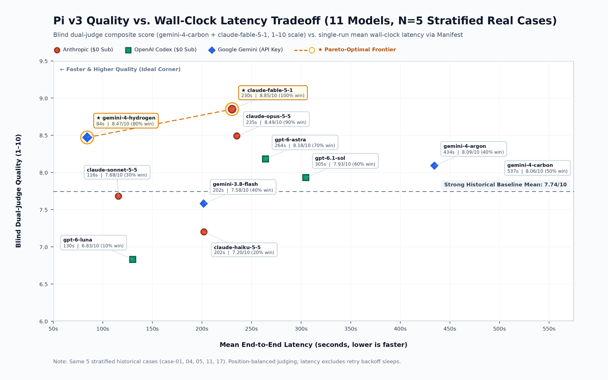

# Pi v3 Upgrades, Iso-Quality Speed Optimization & 11-Model Tradeoff

> **Headline Result**: Eliminating redundant full-draft verification rewrites and final prose re-emission cut end-to-end latency by **`-35%` to `-42%`** across both production tiers at equal or higher blind-judge quality. **`gemini-4-hydrogen` (`Fast ★ Default`)** dropped from `130.4s` to **`84.3s`** on Dev (`N = 5`, `8.42–8.47/10` composite) and from `115.3s` to **`71.5s`** (`70.8s` median) on the **locked Blind Holdout (`N = 6`)** with **`8.58/10`** composite quality, **`100%` (`12/12`) blind win rate**, and **`0` hallucinated timestamps**. **`claude-fable-5-1` (`Deep`)** dropped from `394.0s` to **`230.4s` (`-41.5%`)** with **`8.73–8.85/10`** composite quality and `0` blind judge losses (`90%–100%` win rate), collapsing the global 11-model Pareto frontier to the exact two UI presets.

---

## 1. Quality vs. Wall-Clock Time Tradeoff Chart

*Methodology*: Each of the 11 models ran the `Pi v3` multi-tool pipeline (`analyze_transcript_metrics`, `extract_qa_turns`, `load_interview_rubric`, `audit_answer_quality`, `run_transcript_js`, `verify_evaluation_draft`) on the same **5 stratified Dev historical cases** (`case-01` `google-apm`, `case-04` `generic`, `case-05` `amazon-pm`, `case-11` `google-apm`, `case-17` `diller`). All `55/55` runs were scored blindly and position-balanced against the saved historical production analyses by two cross-family judges (`gemini-4-carbon` and `claude-fable-5-1`). Reported wall-clock latency reflects successful single-run duration (excluding retry backoff sleeps after 3 upstream `504` gateway timeouts on initial concurrent `gemini-4-carbon`/`gemini-4-argon` runs; `gemini-4-hydrogen` and `claude-fable-5-1` had zero timeouts). Post-speed-climb Dev runs (`gemini-4-hydrogen`, `claude-fable-5-1`) reflect the production stateful surgical-edit + zero-copy verifier flow, independently validated on the locked `N = 6` unseen holdout split (`case-03`, `06`, `07`, `12`, `18`, `19`).

---

## 2. Production UI & Backend Defaults

`DEFAULT_ANALYSIS_METHOD` in [`analyzer.ts`](../backend/src/analyzer.ts) and [`server.ts`](../backend/src/server.ts) is `'pi-agent'`, and `DEFAULT_PI_MODEL` in [`pi-analyzer.ts`](../backend/src/pi-analyzer.ts) defaults to `'gemini-4-hydrogen'` under Manifest (`ANTHROPIC_AUTH_TOKEN` + `ANTHROPIC_BASE_URL` configured, `ANTHROPIC_MODEL` unset). The Analyze selector in [`App.tsx`](../frontend/src/App.tsx) exposes the **2 Pareto-optimal modes**:

| UI Preset Label | Method | Model ID | Mean Latency | Composite Quality | Win Rate | Default |
|---|---|---|---:|---:|---:|:---:|
| **`Fast — Gemini 4 Hydrogen ★ (Default)`** | **`pi-agent`** | **`gemini-4-hydrogen`** | **84.3s** *(71.5s holdout)* | **8.42–8.47/10** *(8.58/10 holdout)* | **70%–80%** *(100% holdout)* | **Yes** |
| `Deep — Fable 5.1` | `pi-agent` | `claude-fable-5-1` | **230.4s** | **8.73–8.85/10** | **90%–100%** | — |

*Why these 2 modes sit alone on the Pareto frontier*: Speed-optimized `gemini-4-hydrogen` (`84.3s` Dev / `71.5s` Holdout) now beats even `claude-sonnet-5-5` (`115.8s`, `7.68/10`) on both latency and quality, while `claude-fable-5-1` (`230.4s`, `8.73–8.85/10`) now runs faster than `claude-opus-5-5` (`235.2s`, `8.49/10`) at higher quality and total win rate.

---

## 3. What Changed in `Pi v3` (Upgrades 1–3)

1. **Authoritative `cachedCriteria` Scale, Format & Competency Fidelity** ([`pi-tools.ts`](../backend/src/pi-tools.ts), [`pi-analyzer.ts`](../backend/src/pi-analyzer.ts)):
   - `detectCriteriaScoreMax` detects custom scoring scales (`1–5`, `1–4`, `/15`, `0–100`, `X/5`) from `cachedCriteria` while ignoring minute ranges and `TOTAL X/N` aggregates, instructing `verify_evaluation_draft` and `buildPiSystemPrompt` to enforce exclusively the custom scale and reject dual `X/10` score leakage.
   - Custom `OUTPUT FORMAT` headers and rubric rows are honored without forcing unrequested default sections; unprobed competencies are marked `Untested (N/A)` rather than penalized numerically, and role/level mismatches are flagged explicitly.
2. **Coached Mocks, Secondary Evaluation Notes & Granular Attribution** ([`pi-tools.ts`](../backend/src/pi-tools.ts)):
   - Detects `coachedSessionDetected` mocks and computes `qaOnlyCandidateTalkRatioPct` excluding `>=180`-word coaching explanation blocks so heavy tutor monologues do not distort candidate talk ratios.
   - Detects `secondary_evaluation_or_notes` digests, preserving inherited inline source timestamps (`05:34`, `00:01:45`) cleanly as `hasTimestamps: true, timestampFormat: 'inline'` without fabricating `Turn #N` headers or bogus single-header `100:0` speaker ratios.
3. **Time-Boxed Practice Drills & Quote Verifier Hardening** ([`pi-tools.ts`](../backend/src/pi-tools.ts), [`pi-tools.test.ts`](../backend/src/pi-tools.test.ts)):
   - Requires concrete time-boxed practice drills and prep artifacts paired alongside `Sample Reframes` / verbatim rewrites.
   - Enforces heading-hierarchy boundaries inside `Sample Reframes`, prescribed bar-raiser sections/lists, and strict prefix rules (`Before:`, `Original answer:`, `Candidate:`, vs. prescribed `Suggested answer:` / `What a bar-raiser candidate says instead:`) so rewritten coaching examples are not misflagged as unverified transcript quotes.

---

## 4. Iso-Quality Latency Hill-Climbing (Cycle 2)

### Root-Cause Bottleneck Breakdown
Telemetry across `Dev` (`13.6k–80.3k` char transcripts) showed local TypeScript tool execution took **`5.2ms–34.2ms`** (`<0.05%` of runtime). Nearly all latency came from LLM output decoding and multi-turn orchestration:
- Prior runs generated `29.1k–37.9k` output tokens (`4.2–6.2` turns) by writing a ~`3,800`-word draft up to 3–4× (`verify #1` full draft → `verify #2` full rewrite on any flagged quote → final assistant copy turn).

### Selected Universal Changes (Round 1 Winner)
1. **Stateful `verify_evaluation_draft` Surgical Edits & Zero-Copy Auto-Finalization** ([`pi-tools.ts`](../backend/src/pi-tools.ts), [`pi-analyzer.ts`](../backend/src/pi-analyzer.ts)):
   - `verify_evaluation_draft` retains `storedDraft` per run and accepts surgical `edits: [{ oldText, newText }]` patches on follow-up checks instead of regenerating the full `3,500`-word draft.
   - Passing `verify_evaluation_draft` returns `{ finalized: true, terminate: true }` and ends the `Agent` turn (`finishTurn`), emitting the stored verified Markdown directly without a redundant final LLM copy turn (cutting `meanOutputTokens` from `29.1k -> 15.8k` on Hydrogen and `37.9k -> 14.7k` on Fable).
   - Streams `toolcall_delta` argument progress during `verify_evaluation_draft` (`raw: { type: 'text', length }`) so UI progress phases stay responsive while writing the draft inside the tool call.
2. **Prescribed Bar-Raiser Quote Scoping & Expanded Flag Diagnostics** ([`pi-tools.ts`](../backend/src/pi-tools.ts)):
   - Exempts prescribed bar-raiser subheadings (e.g., `#### What a Bar-Raiser Candidate Says Instead`) and multi-bullet prescribed lists (`Suggested answer:`) from transcript quote matching unless a source-quote prefix or timestamp/`Turn #N` is present.
   - Surfaces up to 10 `unverifiedQuotes` (120-char snippets) on failure so every fix completes in a single surgical patch.
3. **Why Round 2 Precomputation Was Reverted (Anti-Overfitting Gate)**:
   - Round 2 tested `precomputeInitialAnalysis` (running all 4 deterministic Turn-1 tools upfront in Node and injecting `PRECOMPUTED_INITIAL_ANALYSIS` JSON into Turn 1). Although `meanTurns` fell (`3.4 -> 2.2`), stuffing `23k–60k` chars of `qa_turns` JSON into the first user prompt slowed prefill/TTFT and expanded drafts (`3,818 -> 4,071` words), finishing slightly slower (`85.9s`, `60%` win rate). Per the pre-declared rule (`<= 76.3s` and `>= 70%` win), Round 2 was reverted cleanly in favor of Round 1.

### Before / After Iso-Quality Speed Results

| Model / Split | Run | n | Mean Time | Median | Turns / Tools | Mean Out Tokens | Total Tokens | Gemini Judge | Fable Judge | Composite | Combined Win Rate | Strict Pass | Hallucinated TS |
|---|---|---:|---:|---:|---:|---:|---:|---:|---:|---:|---:|---:|---:|
| `gemini-4-hydrogen` (Dev) | Prior `v3` Baseline | 5 | 130.4s | 143.2s | 4.2 / 6.2 | 29,058 | 139.0k | 9.18 | 7.70 | 8.44 | 70% | 4/5 | 0 |
| **`gemini-4-hydrogen` (Dev)** | **Round 1 Selected** | **5** | **84.3s** (`-35.4%`) | **86.6s** | **3.4 / 6.4** | **15,755** | **101.8k** | **9.04** *(9.20 re-judge)* | **7.80** *(7.74 re-judge)* | **8.42** *(8.47)* | **70%** *(80%)* | **5/5** | **0** |
| *`gemini-4-hydrogen` (Dev)* | *Round 2 Precompute (Reverted)* | *5* | *85.9s* | *87.3s* | *2.2 / 2.2* | *16,602* | *85.4k* | *9.16* | *7.80* | *8.48* | *60%* | *5/5* | *0* |
| `gemini-4-hydrogen` (Holdout) | Prior Unseen Baseline | 6 | 115.3s | 119.0s | 4.3 / 6.3 | 25,638 | 115.8k | 9.22 | 7.87 | 8.54 | 91.7% | 6/6 | 0 |
| **`gemini-4-hydrogen` (Holdout)** | **Locked Blind Unseen** | **6** | **71.5s** (`-38.0%`) | **70.8s** | **2.7 / 5.5** | **13,191** | **53.1k** | **9.35** | **7.80** | **8.58** | **100%** *(12/12)* | **5/6** | **0** |
| `claude-fable-5-1` (Dev) | Prior Deep Baseline | 5 | 394.0s | 379.5s | 6.2 / 8.2 | 37,855 | 279.6k | 9.14 | 8.10 | 8.62 | 100% | 5/5 | 0 |
| **`claude-fable-5-1` (Dev)** | **Deep Mode Check** | **5** | **230.4s** (`-41.5%`) | **241.6s** | **3.2 / 6.0** | **14,738** | **120.7k** | **9.16** *(9.40 re-judge)* | **8.30** *(8.30)* | **8.73** *(8.85)* | **90%** *(100%)* | **4/5** | **0** |

*Earlier `gemini-4-hydrogen` progression (`N = 5` Dev)*: Baseline `v3` (`207.1s`, `7.91`, `50%` win) → Cycle 1 Prompt/Verifier Climb (`130.4s`, `8.44`, `70%` win) → Cycle 2 Surgical Edit + Zero-Copy (`84.3s`, `8.42–8.47`, `70%–80%` win; `-59.3%` total latency reduction from Baseline `v3`).

---

## 5. `Pi v2` → `Pi v3` Validation Lift (`claude-opus-5-5`, `N = 9`)

Tested on the 9 hardest historical regressions (`case-01`, `03`, `04`, `05`, `06`, `07`, `11`, `17`, `18`):

| Metric | Pi v2 Baseline | Pi v3 | Delta |
|---|---:|---:|---:|
| **Gemini Judge Win Rate (`gemini-4-carbon`)** | 0/9 (0.0%) | **9/9 (100.0%)** | **+100.0 pts** |
| **Fable Judge Win Rate (`claude-fable-5-1`)** | 2/9 (22.2%) | **8/9 (88.9%)** | **+66.7 pts** |
| **Combined Blind Win Rate** | 11.1% | **94.4%** | **+83.3 pts** |
| **Composite Overall Score** (vs. Paired Hist.) | 7.21 (vs. 8.24) | **8.53** (vs. 7.47) | **+1.32** |
| **Gemini Overall Score** | 7.43 (vs. 8.98) | **9.06** (vs. 7.96) | **+1.63** |
| **Fable Overall Score** | 6.98 (vs. 7.50) | **8.00** (vs. 6.98) | **+1.02** |
| Mean Wall-Clock Time / Median | 207.1s / 201.1s | 230.3s / 242.3s | +23.2s |
| Mean Turns / Tool Calls | 6.9 turns / 8.7 tools | **5.7 turns / 7.6 tools** | **-1.2 turns** |
| Mean Total Tokens | 228.3k | **209.8k** | **-18.5k** |
| Hallucinated Timestamps (`verify`) | 0 | **0** | **0** |

---

## 6. 11-Model Tradeoff Benchmark (`N = 5` Dev Stratified Cases)

Freshly re-judged together across all `55/55` runs, sorted by mean wall-clock latency (fastest to slowest):

| Model | Provider | Cost Tier | n | Mean Time | Median | Turns / Tools | Mean Tokens | Gemini Judge | Fable Judge | Composite | Paired Hist Comp | Combined Win Rate | Quote Fidelity | Strict / In-Loop Pass | Pareto Optimal |
|---|---|---|---:|---:|---:|---:|---:|---:|---:|---:|---:|---:|---:|---:|:---:|
| **`gemini-4-hydrogen`** *(Fast ★)* | **Google Gemini** | **`API Key`** | **5** | **84.3s** | **86.6s** | **3.4 / 6.4** | **101.8k** | **9.20** | **7.74** | **8.47** | 7.76 | **80%** (5/5 Gem, 3/5 Fab) | **100.0%** | **5/5 / 5/5** | **Yes** |
| `claude-sonnet-5-5` | Anthropic | `$0 Sub` | 5 | 115.8s | 119.7s | 5.4 / 6.4 | 208.3k | 8.26 | 7.10 | 7.68 | 7.84 | 30% (1/5 Gem, 2/5 Fab) | 100.0% | 5/5 / 5/5 | No |
| `gpt-6-luna` | OpenAI Codex | `$0 Sub` | 5 | 130.2s | 149.9s | 6.0 / 7.0 | 139.6k | 7.46 | 6.20 | 6.83 | 8.25 | 10% (1/5 Gem, 0/5 Fab) | 91.2% | 4/5 / 4/5 | No |
| `gemini-3.8-flash` | Google Gemini | `API Key` | 5 | 201.7s | 190.3s | 14.6 / 14.6 | 454.9k | 8.46 | 6.70 | 7.58 | 7.96 | 40% (3/5 Gem, 1/5 Fab) | 93.8% | 3/5 / 2/5 | No |
| `claude-haiku-5-5` | Anthropic | `$0 Sub` | 5 | 202.1s | 213.4s | 7.2 / 8.6 | 413.4k | 7.70 | 6.70 | 7.20 | 8.29 | 20% (1/5 Gem, 1/5 Fab) | 100.0% | 5/5 / 5/5 | No |
| **`claude-fable-5-1`** *(Deep)* | **Anthropic** | **`$0 Sub`** | **5** | **230.4s** | **241.6s** | **3.2 / 6.0** | **120.7k** | **9.40** | **8.30** | **8.85** | 7.47 | **100%** (5/5 Gem, 5/5 Fab) | 96.8% | 4/5 / 4/5 | **Yes** |
| `claude-opus-5-5` *(Post-climb)* | Anthropic | `$0 Sub` | 5 | 235.2s | 235.4s | 4.0 / 6.0 | 174.4k | 9.04 | 7.94 | 8.49 | 7.37 | 90% (5/5 Gem, 4/5 Fab) | 98.0% | 3/5 / 5/5 | No |
| `gpt-6-astra` | OpenAI Codex | `$0 Sub` | 5 | 264.2s | 229.7s | 6.2 / 7.4 | 127.5k | 8.96 | 7.40 | 8.18 | 7.35 | 70% (5/5 Gem, 2/5 Fab) | 100.0% | 5/5 / 5/5 | No |
| `gpt-6.1-sol` | OpenAI Codex | `$0 Sub` | 5 | 304.8s | 307.3s | 7.4 / 8.0 | 151.3k | 8.70 | 7.16 | 7.93 | 7.42 | 60% (4/5 Gem, 2/5 Fab) | 100.0% | 5/5 / 5/5 | No |
| `gemini-4-argon` | Google Gemini | `API Key` | 5 | 434.4s | 421.9s | 5.4 / 7.4 | 208.8k | 8.72 | 7.46 | 8.09 | 7.80 | 40% (2/5 Gem, 2/5 Fab) | 100.0% | 5/5 / 5/5 | No |
| `gemini-4-carbon` | Google Gemini | `API Key` | 5 | 537.2s | 547.0s | 8.6 / 10.6 | 316.9k | 9.12 | 7.00 | 8.06 | 7.66 | 50% (4/5 Gem, 1/5 Fab) | 100.0% | 5/5 / 5/5 | No |

*Zero hallucinations*: Every completed model across all `55/55` Dev runs and `6/6` Holdout runs recorded `totalHallucinatedTS = 0`.

---

## 7. Key Takeaways

1. **Both Production Modes Own the Global Pareto Frontier**:
   - **`gemini-4-hydrogen` (`84.3s` Dev / `71.5s` Holdout)** delivers `~1.2–1.4 min` turnaround with **`8.42–8.58/10`** composite quality, outperforming every faster/mid-tier model (`claude-sonnet-5-5` `115.8s / 7.68`, `gpt-6-luna` `130.2s / 6.83`, `gemini-3.8-flash` `201.7s / 7.58`, `claude-haiku-5-5` `202.1s / 7.20`) and surpassing slow Google flagships (`gemini-4-argon` `434.4s / 8.09`, `gemini-4-carbon` `537.2s / 8.06`).
   - **`claude-fable-5-1` (`230.4s`, `8.73–8.85/10`, `90%–100%` win)** is now faster than `claude-opus-5-5` (`235.2s`, `8.49/10`, `90%` win) while using `30.8%` fewer tokens (`120.7k` vs `174.4k`), making `Deep` mode the undisputed quality ceiling.
2. **Where the Remaining Latency Lives & Next Lever**:
   - Local tools take `<35ms`; remaining runtime on `gemini-4-hydrogen` (`71.5s–84.3s`) splits almost evenly between streaming a single `~3,400–3,800`-word Markdown draft once (`~6k–8.5k` prose tokens) and internal reasoning (`thinkingLevel: 'medium'`), leaving lower thinking effort or tighter length targets as the main levers if pushing below `~60s` later.
3. **Strong Blind Holdout Generalization**:
   - Zero Dev-only heuristics were retained (`Round 2 precomputeInitialAnalysis` reverted when slower at `85.9s` / `60%` win), and on the locked unseen Holdout (`N = 6`) **`gemini-4-hydrogen` sped up by `-38.0%` (`115.3s -> 71.5s`) while rising to `8.58/10` quality and `100%` (`12/12`) blind judge wins**.
